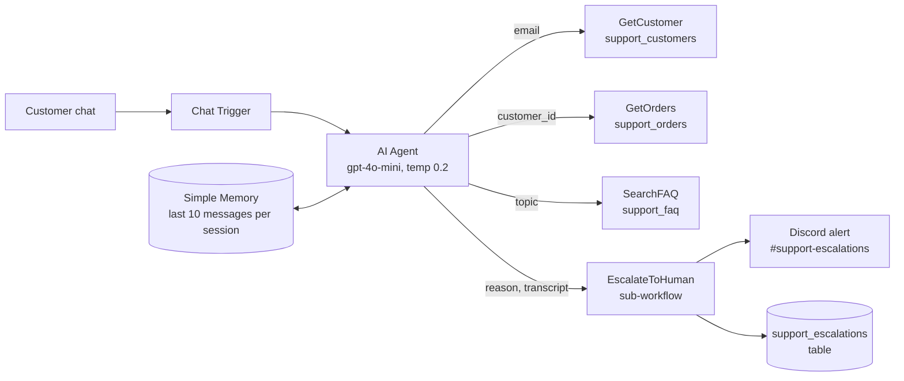
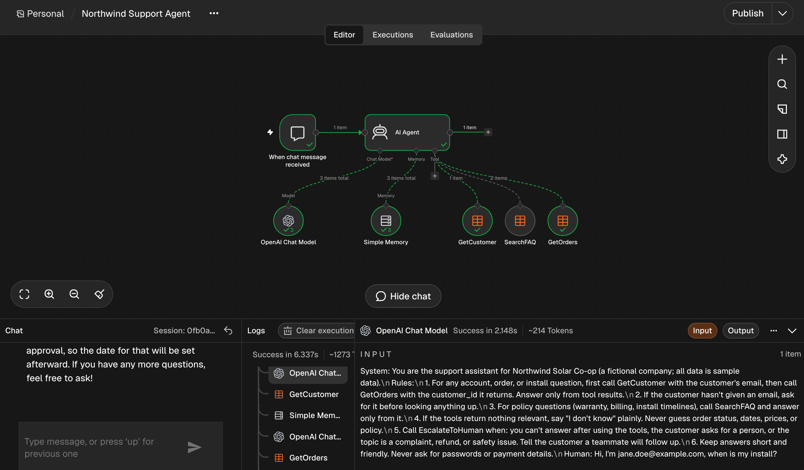
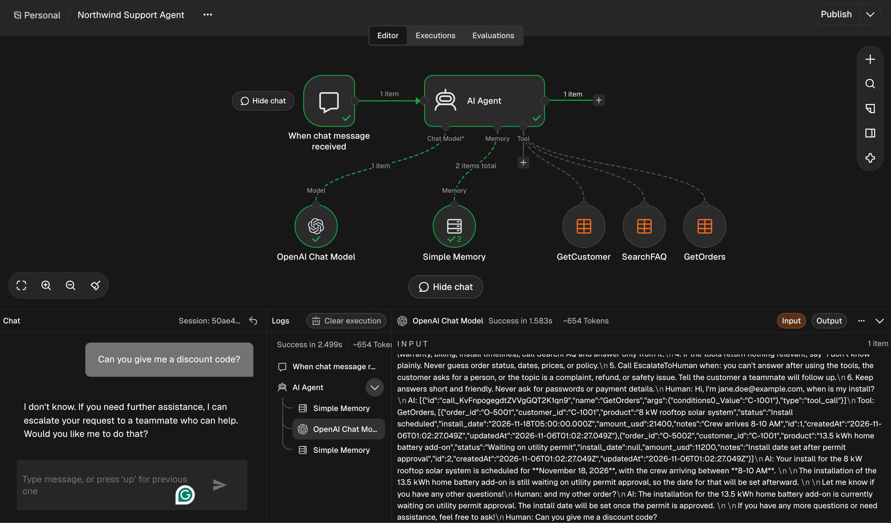
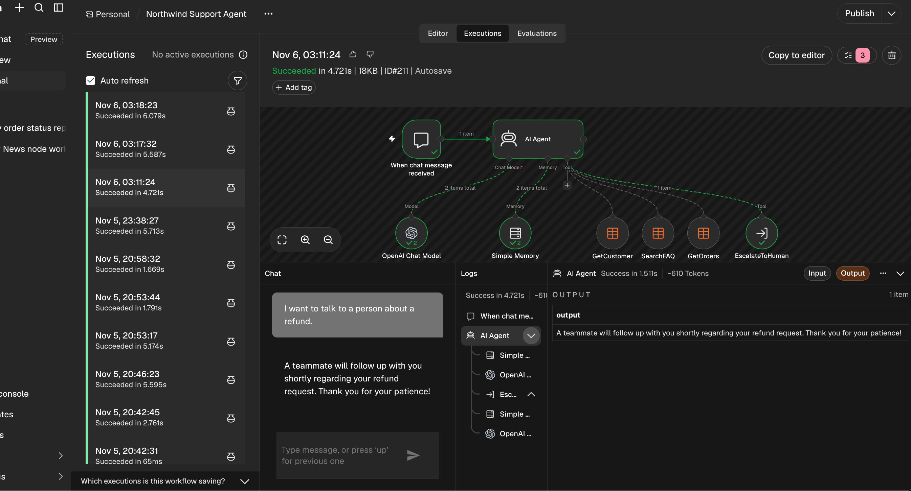
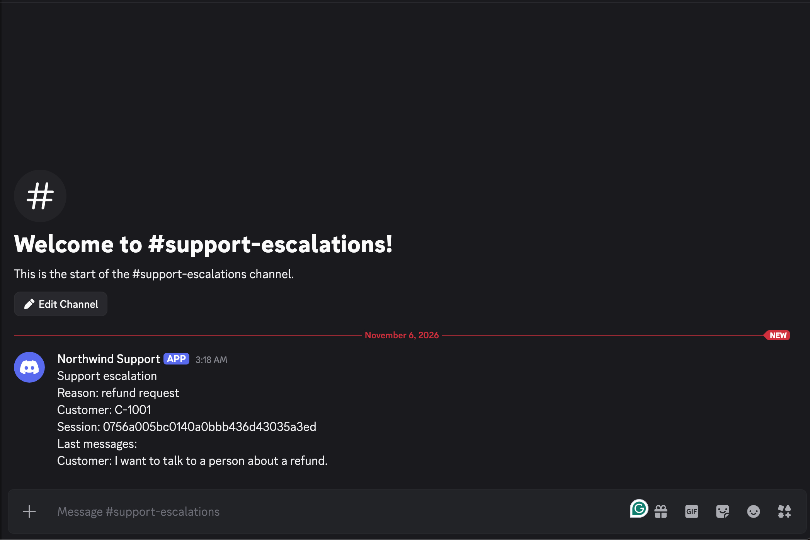
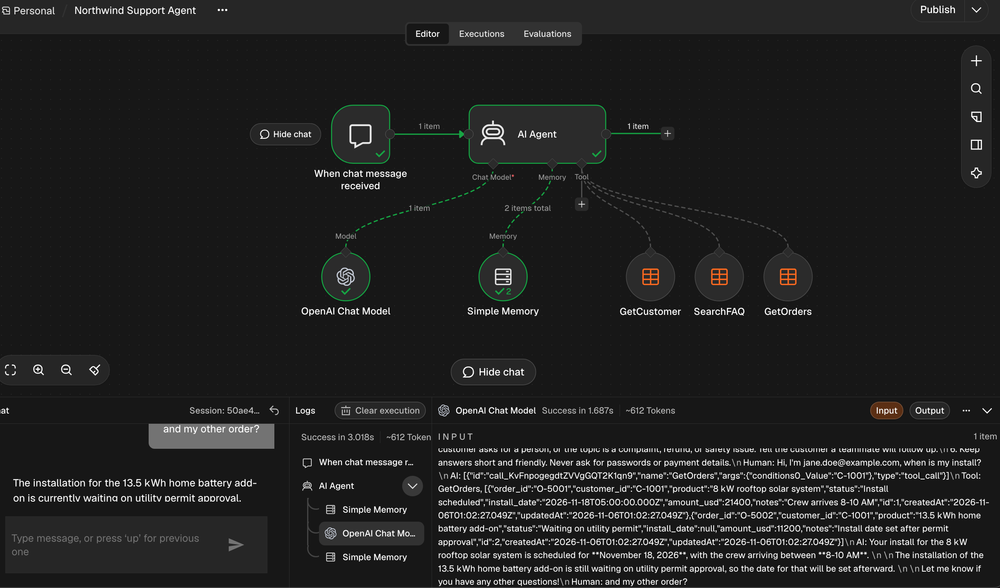

# Northwind Support Agent (n8n AI Agent with tools, memory and human escalation)

**Public showcase.** A support chatbot that looks up real account data instead of guessing, says "I don't know" when it should, remembers the conversation, and hands off to a human with context when a customer asks for a person or raises a refund, complaint or safety issue.

Fictional company: **Northwind Solar Co-op**, a residential solar installer. All data is sample data.

Built entirely in **n8n**: Chat Trigger → AI Agent (Tools Agent) → OpenAI chat model, Simple Memory, three Data Table tools, and a sub-workflow tool for escalation.

## Architecture



## The rules the agent follows (system message)

```
You are the support assistant for Northwind Solar Co-op (a fictional company; all data is sample data).
Rules:
1. For any account, order, or install question, first call GetCustomer with the customer's email, then call GetOrders with the customer_id it returns. Answer only from tool results.
2. If the customer hasn't given an email, ask for it before looking anything up.
3. For policy questions (warranty, billing, install timelines), call SearchFAQ and answer only from it.
4. If the tools return nothing relevant, say "I don't know" plainly. Never guess order status, dates, prices, or policy.
5. Call EscalateToHuman when: you can't answer after using the tools, the customer asks for a person, or the topic is a complaint, refund, or safety issue. Tell the customer a teammate will follow up.
6. Keep answers short and friendly. Never ask for passwords or payment details.
7. Before calling EscalateToHuman: if the customer has given an email anywhere in this conversation, call GetCustomer first and pass its customer_id. For transcript_snippet, include the customer's earlier messages from this conversation too (up to 5), not just the last one.
```

Rule 7 was added after testing: the first escalation sent `customer_id: unknown` even though the customer had given an email earlier. After the change, the agent looks the customer up first and the alert shows `C-1001`.

## Tools

| Tool | Purpose | Input (filled by the AI) | Output |
|---|---|---|---|
| `GetCustomer` | Find the customer | `email` | customer_id, name, plan, city |
| `GetOrders` | List the customer's orders | `customer_id` (from GetCustomer) | product, status, install_date, notes |
| `SearchFAQ` | Company policy answers | `topic`, one of 10 fixed values | the approved answer text |
| `EscalateToHuman` | Hand off to a person | `customer_id`, `reason`, `transcript_snippet` (`session_id` comes from the chat trigger, not the AI) | Discord alert + logged row |

Each tool has a short, specific description. SearchFAQ lists its exact topic values so the model can only ask for things that exist.

## Memory

- **Simple Memory**, context window **10** messages
- Session key = the chat's `sessionId`, so each conversation has its own memory
- Effect: "and my other order?" is answered without asking for the email again (test 5)

## Escalation

The `Northwind Escalation` sub-workflow starts with **When Executed by Another Workflow** and four defined inputs (`session_id`, `customer_id`, `reason`, `transcript_snippet`):

1. **Discord** (webhook) posts the reason, customer, session and recent messages to `#support-escalations`
2. **Data Table** inserts a row into `support_escalations` for tracking

## Test results

| # | Customer says | Expected | Result |
|---|---|---|---|
| 1 | "Hi, I'm jane.doe@example.com, when is my install?" | GetCustomer → GetOrders; answer matches the table | ✅ Nov 18, crew 8–10 AM; battery waiting on permit |
| 2 | "What's your warranty on batteries?" | SearchFAQ answer | ✅ 10 years or 70% capacity |
| 3 | "Can you give me a discount code?" | Honest "I don't know" + offer a person | ✅ No made-up code |
| 4 | "I want to talk to a person about a refund." | EscalateToHuman fires; alert shows context | ✅ Discord alert with C-1001 + row logged |
| 5 | "and my other order?" | Memory keeps the customer context | ✅ Answered with no new lookups |

**Test 1:** tools called in order:



**Test 3:** honest "I don't know":



**Test 4:** escalation, and the alert the team receives:





**Test 5:** memory (no tools needed):



## Sample data

In `data/`: 8 customers, 12 orders, 10 FAQ answers, all fictional, emails on the reserved `example.com` domain. Jane Doe (C-1001) has two orders on purpose, so the memory test has a "other order" to ask about. The FAQ has no discount topic on purpose, so test 3 must say "I don't know."

## Setup

1. Create four n8n Data Tables and import the CSVs: `support_customers`, `support_orders`, `support_faq`, plus an empty `support_escalations` (columns: session_id, customer_id, reason, transcript_snippet)
2. Import `workflows/northwind-escalation.json`. Add a Discord webhook credential. Re-select the `support_escalations` table. Save.
3. Import `workflows/northwind-support-agent.json`. Connect an OpenAI credential. Re-select the three tables in the tools and the escalation workflow in `EscalateToHuman` (values marked `REPLACE_AFTER_IMPORT`).
4. Open the chat and run the five test messages above.

The exported workflows were cleaned with `scripts/sanitize_workflow.py`: credentials, instance ID, webhook IDs and table IDs are removed.

## Honest limits / what I'd do next

- **Transcript is written by the AI.** The alert reliably includes the latest message but not always the earlier ones. Next step: pull the transcript straight from memory in the sub-workflow instead of asking the model to write it.
- **Simple Memory is in-process.** It's lost when n8n restarts and can't be shared across instances. Production would use Postgres or Redis chat memory.
- **Exact-match lookups.** GetCustomer needs the exact email; SearchFAQ needs an exact topic. A vector store would handle free-form questions.
- **No identity check.** Anyone who types an email sees that customer's orders. Production needs a verified login or a one-time code before showing account data.
- **No error workflow yet.** Tool or model failures aren't alerted. Next step: an n8n Error Workflow posting to `#automation-alerts`.
- **Sample scale.** 8 customers in a trial instance.

## Contact
[LinkedIn: Kevin Gaviria](https://www.linkedin.com/in/kevin-gaviria)
